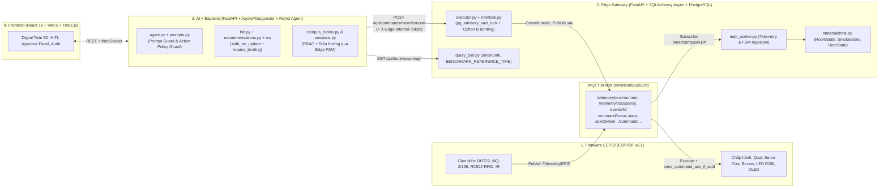
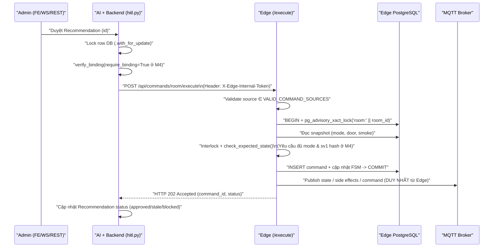

# SmartCampus — Tổng Quan Kiến Trúc Hệ Thống (Phiên Bản Sau Khi Khắc Phục Mức 1–3, Option B)

Tài liệu này mô tả kiến trúc hoàn chỉnh của hệ thống **SmartCampus** (IoT + Edge FSM + AI Agent + Human-in-the-Loop + Digital Twin Frontend) sau khi hoàn tất gói nâng cấp an toàn, tính nguyên tử (atomicity), đồng bộ firmware ESP32 và chuẩn hóa benchmark **M0–M4**.

---

## 1. Kiến Trúc Tổng Thể (4 Phân Hệ)

SmartCampus được tổ chức theo mô hình **Dual-Sovereignty (Song quyền An toàn)**: **AI + Backend** đóng vai trò phân tích ngữ cảnh và đề xuất hành động (*Advisory Plane*), còn **Edge Gateway** nắm quyền kiểm soát trạng thái vật lý và thực thi thiết bị (*Execution & Safety Plane*), tách biệt hoàn toàn với phần cứng ESP32 và giao diện quản trị Digital Twin.

### Thành phần kỹ thuật từng phân hệ

| Phân hệ | Vị trí | Stack chính | Vai trò cốt lõi |
|---|---|---|---|
| **Firmware ESP32** | [`firmware/`](file:///home/user_kma_chinh/SmartCampus/firmware/src/main.c) | ESP-IDF v6.1, FreeRTOS, C, `cjson`, `esp-mqtt` | Đọc cảm biến, quét thẻ RFID, thực thi lệnh phòng/thiết bị và gửi ACK theo `command_id`. Hỗ trợ build đa vai trò (`ROLE_ROOM_NODE_1`, `ROLE_ROOM_NODE_2`, `ROLE_CORRIDOR_NODE`, `ROLE_OLED_DISPLAY_NODE`). |
| **Edge Gateway** | [`edge/`](file:///home/user_kma_chinh/SmartCampus/edge/main.py) | Python, FastAPI, SQLAlchemy Async, PostgreSQL (`asyncpg`/`psycopg`), `aiomqtt` | Lưu chuỗi thời gian telemetry/trạng thái (`environment`, `occupancy`, `room_state`, `room_smoke_state`, `room_door_state`, `command`), vận hành FSM, khóa interlock & TOCTOU, xuất bản lệnh MQTT duy nhất. |
| **AI + Backend** | [`AI + Backend/`](file:///home/user_kma_chinh/SmartCampus/AI%20%2B%20Backend/requirements.txt) | Python 3.12, FastAPI, SQLAlchemy Async, `pgvector`, `google-genai`, `aiomqtt`, JWT/RBAC | Chạy ReAct Agent (Gemini / Ollama), Prompt Guard + Action Policy Enforcement, RAG/LTM, lưu `Recommendation`, luồng duyệt HITL, đồng bộ WebSocket & phiên điểm danh. |
| **Frontend** | [`frontend/`](file:///home/user_kma_chinh/SmartCampus/frontend/package.json) | React 19, TypeScript 5.7, Vite 8, Three.js 0.186, Tailwind CSS 4 | Giao diện quản trị campus 3D, hiển thị cảnh báo notable, hộp thoại phê duyệt HITL và nhật ký lệnh. |

---

## 2. Giao Thức MQTT & Đồng Bộ ESP32 Firmware

Mọi giao tiếp giữa phần cứng ESP32 và Edge Gateway chạy dưới namespace `smartcampus/v1/` (định nghĩa trong [`firmware/include/app_config.h`](file:///home/user_kma_chinh/SmartCampus/firmware/include/app_config.h#L135-L147)):

| Topic MQTT | Chiều | Nội dung |
|---|---|---|
| `smartcampus/v1/telemetry/room/%s/environment` | ESP32 → Edge | Nhiệt độ, độ ẩm, `smoke_detected`, `smoke_value`, `smoke_threshold`, `smoke_state`, `co2`, `air_quality` |
| `smartcampus/v1/telemetry/room/%s/occupancy` | ESP32 → Edge | Hiện diện & số lượng người (`mqtt_worker.py` đã sửa lỗi thiếu `await` khi publish phản hồi) |
| `smartcampus/v1/event/room/%s/rfid` | ESP32 → Edge | Quét thẻ RC522, điểm danh & kích hoạt sự kiện notable khi có thẻ lạ |
| `smartcampus/v1/room/%s/state` | Edge → ESP32 | Đồng bộ chế độ phòng hiện tại (`LECTURE`, `EXAM`, `SAVING`, `LOCK`, `EMERGENCY`) |
| `smartcampus/v1/command/room/%s` | Edge → ESP32 | Lệnh thực thi thống nhất (kèm `command_id` UUID do Edge cấp sau commit DB) |
| `smartcampus/v1/ack/device/%s/command/%s` | ESP32 → Edge | Xác nhận thực thi lệnh theo `command_id` |

### Điểm mới đồng bộ ở Firmware ([`app_mqtt.c`](file:///home/user_kma_chinh/SmartCampus/firmware/src/app_mqtt.c))

1. **ACK thống nhất cho mọi actuator**: Bổ sung helper `send_command_ack_if_uuid(...)` để gửi ACK về `TOPIC_COMMAND_ACK` cho **`door`**, **`buzzer`**, **`led_strip`/`light`** tương tự như `fan` (trước đây chỉ có `fan` gửi ACK).
2. **Tương thích alias `"light"` và `"led_strip"`**: Router nhận lệnh trên ESP32 chấp nhận cả `"light"` (tool catalog chuẩn hóa của AI/Edge) lẫn `"led_strip"`, giúp K09-02 hoạt động thông suốt trên phần cứng thật.
3. **Chính sách quạt thông gió trong `EMERGENCY`**: Tài liệu & firmware làm rõ giữ nguyên khả năng điều khiển bật quạt thông gió (`fan:on`) phục vụ thoát khói khẩn cấp, đồng bộ bất biến `K11-02`.

---

## 3. Edge FSM, Interlock & Thực Thi Nguyên Tử (Mức 2 + Mức 3 Option B)

### 3.1. Quản lý trạng thái & khôi phục khói (`statemachine.py`)

Edge duy trì 3 chiều trạng thái chính trong PostgreSQL cho mỗi phòng:
- **`RoomState`**: `LECTURE`, `EXAM`, `SAVING`, `LOCK`, `EMERGENCY`.
- **`SmokeState`**: `NORMAL`, `SUSPECTED`, ...
- **`DoorState`**: `LOCKED`, `UNLOCKED`.

Các cải tiến quan trọng trong [`statemachine.py`](file:///home/user_kma_chinh/SmartCampus/edge/feature/FSM/statemachine.py):
- **Khôi phục `SmokeState.NORMAL` ngay cả khi phòng đang `LOCK` / `EXAM` / `SAVING` / `LECTURE`**: Trong `handle_smoke_event()`, khi khói trở về `NORMAL` mà `state_recovery()` trả `False` (tức không cần khôi phục `RoomState`), Edge **vẫn ghi nhận `SmokeState.NORMAL`** vào DB thay vì bỏ qua như trước; đồng thời `state_recovery()` fallback (khi `recovery_record is None`) reset đồng bộ `SmokeState.NORMAL`, `DoorState.LOCKED`, tắt LED strip & buzzer.
- **Entry Timestamp cho State Versioning (Sửa `K06-04`)**: `_get_latest_state_and_ts()` tính **thời điểm bắt đầu chuỗi trạng thái liên tiếp hiện tại** thay vì lấy `timestamp` của bản ghi heartbeat mới nhất giống hệt nhau; đồng thời `set_current_state()` bỏ qua chèn bản ghi trùng giá trị không đổi. Điều này đảm bảo:
  - Heartbeat lặp cùng trạng thái (`A@t1 -> A@t2`, ca **K06-04**) **không** làm vô hiệu hóa đề xuất đang chờ duyệt.
  - Chuỗi dao động có chuyển trạng thái rồi quay lại (`A -> B -> A`, ca **K03-01**, **K08-01**) **vẫn đổi entry timestamp**, bắt buộc đánh dấu `STALE_APPROVAL`.

### 3.2. Giao dịch nguyên tử & chống TOCTOU Race (`executor.py`, `router.py`, `interlock.py`)

Các đảm bảo mới sau khi sửa Mức 2 & Mức 3:
1. **Single Transaction + Advisory Lock**: `execute_room_command()` gộp toàn bộ bước đọc snapshot, kiểm tra interlock, kiểm tra TOCTOU, ghi bảng `command` và cập nhật FSM vào **một giao dịch SQL duy nhất**, khóa theo phòng bằng `pg_advisory_xact_lock(func.hashtext(f"room:{room_id}"))`.
2. **DB Commit trước MQTT Publish**: Mọi lệnh MQTT (`room_state`, `led_strip`, side effects và frame `command` chứa `command_id`) chỉ được gửi **sau khi `await db.commit()` thành công**.
3. **Edge là nguồn Publish MQTT Lệnh Duy Nhất**: Đã xóa nhánh backup MQTT publish trùng lặp trong [`hitl.py`](file:///home/user_kma_chinh/SmartCampus/AI%20%2B%20Backend/app/campus/hitl.py) (sau khi Edge đã trả HTTP 200/202) và chuyển [`campus_rooms.py`](file:///home/user_kma_chinh/SmartCampus/AI%20%2B%20Backend/app/api/campus_rooms.py) (`/state`, `/fan`, `/door`) đi hoàn toàn qua Edge FSM qua `_dispatch_room_command_via_edge()` thay vì tự publish MQTT trực tiếp.
4. **Xác thực nguồn & Token nội bộ**: [`edge/feature/command/router.py`](file:///home/user_kma_chinh/SmartCampus/edge/feature/command/router.py) kiểm tra `source` thuộc `VALID_COMMAND_SOURCES` và kiểm tra header `X-Edge-Internal-Token` khi `EDGE_INTERNAL_TOKEN` được cấu hình.
5. **Fail-closed Partial Binding (`K15-03`)**: Ở `source="admin_hitl"`, `check_expected_state()` từ chối nếu thiếu `expected_mode` **hoặc** thiếu `expected_version`. Tương ứng ở Backend, `verify_binding(..., require_binding=True)` trả `(False, "missing_binding")` nếu recommendation thiếu metadata ràng buộc.
6. **Chính sách Option B cho `compute_composite_state_version()`**: Giữ nguyên hàm băm gộp toàn phòng `sv1:<16_hex>` theo `(mode@ts | door@ts | smoke@ts)` thay vì băm riêng từng thuộc tính theo tool. Quyết định kiến trúc này chấp nhận đánh đổi **2 false-block bảo thủ (`K06-03` và `K07-02`)** khi trạng thái cửa thay đổi trong lúc chờ duyệt lệnh quạt/cảnh báo, đổi lại đảm bảo **khóa chéo toàn diện và độ đơn giản kiểm chứng cao**.

---

## 4. Lớp Bảo Vệ AI & Backend (M0–M4 Ablation Profile)

Hệ thống cấu hình 5 mức bảo vệ phục vụ cả vận hành thực tế lẫn benchmark ablation:

| Profile | `SAFETY_PROMPT_GUARD_ENABLED` | `SAFETY_FSM_ENABLED` | `SAFETY_HITL_ENABLED` | `SAFETY_TOCTOU_BINDING_ENABLED` | Hành vi đặc trưng |
|---|---|---|---|---|---|
| **M0** | `false` | `false` | `false` | `false` | Raw baseline prompt (`RAW_BASELINE_SYSTEM_PROMPT`), không chặn policy tool, tự thực thi không FSM interlock. |
| **M1** | `true` | `false` | `false` | `false` | Bật Prompt Guard + **Runtime `find_action_policy_violations()` trong `_final_safety_check()`** để chặn tool ngoài chính sách của loại event (`PG-02`, `PG-03`). |
| **M2** | `true` | `true` | `false` | `false` | Bật thêm Edge FSM Interlock (`INV_A_NO_UNLOCK`, `INV_B_NO_LOCK_EXIT`, `AUTOPILOT_NO_MODE_CHANGE`). |
| **M3** | `true` | `true` | `true` | `false` | Bật thêm Human-in-the-Loop (đề xuất vào hàng đợi duyệt, chặn duyệt trùng `K13-01`), chưa kiểm tra TOCTOU state binding. |
| **M4** | `true` | `true` | `true` | `true` | **Full Protection**: Bật toàn bộ Prompt/Policy Guard + FSM Interlock + HITL + Option B Composite State Binding & Payload Canonical Verification. |

Các sửa đổi đồng bộ thêm ở Backend:
- **Runtime Policy Enforcement**: [`agent.py`](file:///home/user_kma_chinh/SmartCampus/AI%20%2B%20Backend/app/agent/agent.py) gọi `prompts.find_action_policy_violations()` trong `_final_safety_check()` khi `prompt_guard_enabled()` bật — khắc phục lỗ hổng trước đây khi quy tắc chính sách chỉ là hướng dẫn mềm hoặc nằm ở probe offline.
- **Tách biệt LTM & Fallback cho Benchmark**: Bổ sung `BENCHMARK_DISABLE_LTM` và `DISABLE_FALLBACK` ([`settings.py`](file:///home/user_kma_chinh/SmartCampus/AI%20%2B%20Backend/app/config/settings.py), [`orchestrator.py`](file:///home/user_kma_chinh/SmartCampus/AI%20%2B%20Backend/app/fallback/orchestrator.py)) để các ca benchmark đánh giá năng lực thực của model mà không bị nhiễu bởi LTM hoặc fallback quy tắc ngầm.
- **RBAC & Đồng bộ đồng hồ**: [`sessions.py`](file:///home/user_kma_chinh/SmartCampus/AI%20%2B%20Backend/app/api/sessions.py) gắn `require_role("admin", "lecturer")` cho `student_checkin` và dùng `get_current_time()` nhất quán với Edge `query_tool.py` (`until` & `BENCHMARK_REFERENCE_TIME`).
- **Đồng bộ WS & REST**: Cả API REST [`recommendations.py`](file:///home/user_kma_chinh/SmartCampus/AI%20%2B%20Backend/app/api/recommendations.py) và [`websocket/router.py`](file:///home/user_kma_chinh/SmartCampus/AI%20%2B%20Backend/app/websocket/router.py) đều khóa hàng (`with_for_update()`), kiểm tra binding bắt buộc ở M4 và đồng bộ trạng thái `stale`/`blocked` chính xác.

---

## 5. Trạng Thái Kiểm Chứng Mới Nhất & Tài Liệu Liên Quan

- **Unit Tests**: Edge `35/35 OK` (`0.007s`); AI + Backend `26/26` (`tests/campus`), `10/10` (`test_evaluate.py`), `10 kịch bản` (`test_rag_scenarios.py`) đều đạt; ESP32 firmware biên dịch `SmartCampus-Firmware.bin` qua ESP-IDF v6.1.0 với `0` lỗi.
- **Benchmark Fixture (`cases.csv`, M0–M4)**: `57/57 observed`, `0 inconclusive`, `0 unexpected`, `review_runner.py PASS` ([`fixture-cases-fixed-20261116`](file:///home/user_kma_chinh/SmartCampus/benchmark_local/runs/fixture-cases-fixed-20261116/results_m0_m4.csv)).
- **Live Gemini Benchmark (`all_cases_live.csv`, M0–M4, `gemini-3.8-flash`)**: `57/57 observed`, `0 inconclusive`, `0 fallback`, `0 unexpected` trên `M2–M4`, `edge_frames == 1` & `backend_frames == 0` trên toàn bộ ca `dispatch`, `review_runner.py PASS` ([`all-cases-gemini-fixed-20261116`](file:///home/user_kma_chinh/SmartCampus/benchmark_local/runs/all-cases-gemini-fixed-20261116/results/results_m0_m4.csv)).
- **Báo cáo Benchmark đầy đủ**: Xem [`BENCHMARK_ARTIFACT.md`](file:///home/user_kma_chinh/SmartCampus/BENCHMARK_ARTIFACT.md).
- Bộ script & manifest benchmark: [`experiment/run_benchmark.py`](file:///home/user_kma_chinh/SmartCampus/experiment/run_benchmark.py), [`experiment/cases.csv`](file:///home/user_kma_chinh/SmartCampus/experiment/cases.csv), [`benchmark_local/all_cases_live.csv`](file:///home/user_kma_chinh/SmartCampus/benchmark_local/all_cases_live.csv).
